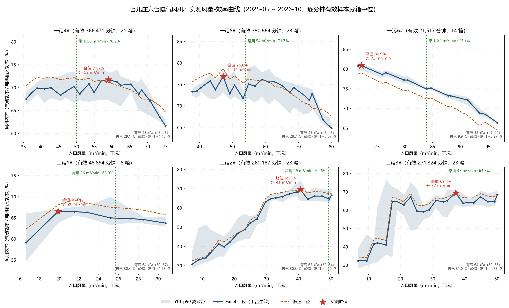
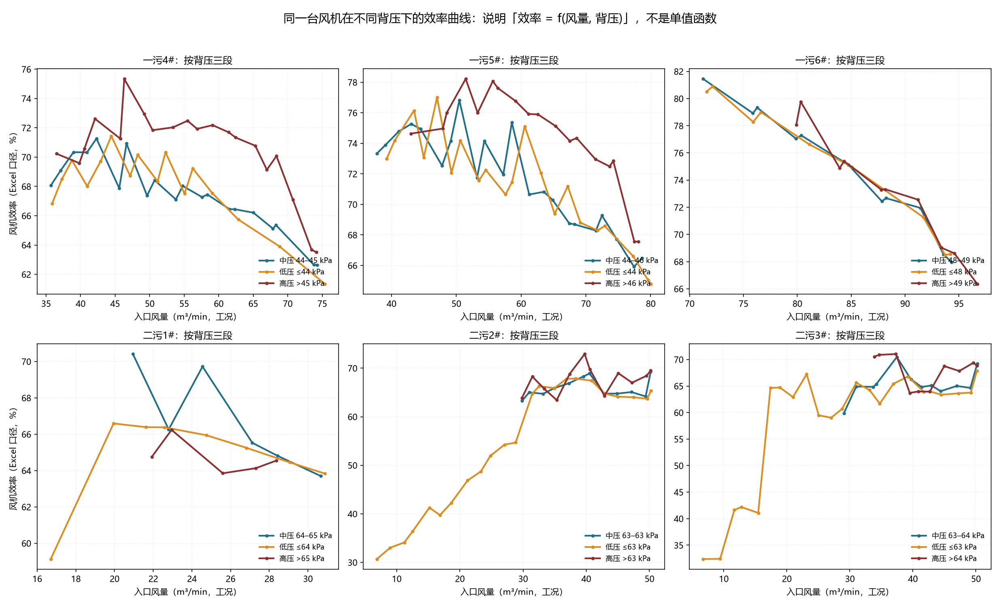

# 效率曲线与「最佳效率」评估（台儿庄六台风机）

日期：2026-10-19
数据：`data/fan-efficiency-taierzhuang/derived/minute-v2.parquet`（2025-05 ~ 2026-10，逐分钟）
样本：仅 `quality == VALID` 的分钟，共 **1,359,257** 行；按 2 m³/min 分箱，箱内 ≥15 样本才出点，取箱内中位
口径：`eta_excel`（平台本期生效）与 `eta_corrected`（严格多变压缩）并列给出
复现：`.\.venv-311\Scripts\python.exe models\_drafts\fan-efficiency-taierzhuang\work\analysis\curve_all_machines.py`

## 1. 结论摘要

1. **曲线能做**，且精度够：六台各 8~23 个风量箱，箱内 p10–p90 离散带宽度多在 3~6 个百分点。
2. **模型输出的不是「最佳效率」**：它算的是「该分钟该工况点的实际效率」，一个测量值，没有寻优含义。最佳效率是曲线的性质，不是单点的性质。
3. 六台里只有 4 台的实测峰值可以当「该台曾达到的最高效率」（峰值在样本覆盖的内部）；一污6#、二污1# 的峰值落在样本边界上，**不可当峰值使用**。

## 2. 六台汇总

| 机组 | 有效分钟 | 箱数 | 实测覆盖风量 p10–p90 | Excel 口径峰值 | 峰值风量 | 常用风量 | 常用点效率 | 峰值−常用 | 峰值可信 | 修正口径峰值 |
| --- | ---: | ---: | ---: | ---: | ---: | ---: | ---: | ---: | --- | ---: |
| 一污4# | 366,471 | 21 | 38.4–62.3 | 71.73% | 59.0 | 50.0 | 70.25% | +1.48 | ✅ 内部 | 72.33% @ 42.8 |
| 一污5# | 390,864 | 23 | 42.6–67.5 | 76.80% | 47.2 | 54.0 | 71.73% | +5.07 | ✅ 内部 | 78.62% @ 47.2 |
| 一污6# | 21,517 | 14 | 76.1–93.7 | 80.89% | 72.1 | 83.9 | 74.92% | +5.97 | ⚠️ 边界 | 79.02% @ 72.1 |
| 二污1# | 48,894 | 8 | 21.7–30.5 | 66.50% | 19.9 | 25.7 | 64.97% | +1.53 | ⚠️ 边界 | 69.32% @ 21.6 |
| 二污2# | 260,187 | 23 | 40.9–50.2 | 69.52% | 40.6 | 49.2 | 64.62% | +4.90 | ✅ 内部 | 69.43% @ 40.6 |
| 二污3# | 271,324 | 23 | 41.3–49.9 | 69.43% | 37.2 | 48.5 | 64.70% | +4.73 | ✅ 内部 | 69.29% @ 23.2 |

「峰值可信」判据：峰值落在样本覆盖的左右边缘（前/后 15% 的箱）→ 曲线在该端仍在单调升降，真实峰值可能在没跑过的工况里，故不可当峰值使用。

## 3. 为什么不能把「实测峰值」直接叫「最佳效率」

三层含义必须分开：

| 层次 | 含义 | 我们现在能回答吗 |
| --- | --- | --- |
| A 实测峰值 | 这段历史里该台效率最高的一次工况点 | ✅ 能，4 台可信、2 台受覆盖限制 |
| B 该台固有最佳效率点（BEP） | 厂家性能曲线上效率最高的工况，与管网无关 | ❌ 需要厂家风量-压力-效率曲线，或现场变风量试验 |
| C 系统最优 | 给定总风量与容差，让总输入功率最小的机台组合与分配 | ❌ 不在本模型职责内，属下游组合模型 |

差别有多大：A 只是 B 的**下界**（该台从没在 BEP 上跑过，就永远测不到它）。一污6# 和二污1# 正是这种情况——它们的曲线在样本边缘仍单调，说明常用工况整体位于峰值一侧，真实峰值在数据覆盖之外。

## 4. 效率不是一个纯风量函数

同一台机、同样风量、背压不同，效率不同（图 2）：一污4# 高压段（>45 kPa）在 40~60 m³/min 普遍比低压段（≤44 kPa）高 **3~5 个百分点**；一污5# 高压段高 **2~4 点**。

含义：

- 第 2 节的曲线是**混合背压**的分箱中位，峰值位置会随背压分布漂移，不能当「该台性能曲线」拿去和厂家样本比。
- 背压高时效率数值高，不代表运行更好——背压高通常意味着管网阻力大（曝气头堵塞、阀门开度小），是否「更好」要看单位风量电耗，不能只看 η。
- 因此若要把曲线当作约束/优化输入，应按 (风量, 背压) 二维使用，或声明固定的背压代表值。

## 5. 两个口径的峰值位置不同，原因可解释

一污4#：Excel 口径峰值在 **59 m³/min**，修正口径峰值在 **43 m³/min**。
原因：修正口径把前导项从标准状态换成入口状态，等价于乘 `T入口/T标准`；一污三台的风量与进气温度相关系数约 **−0.5**（低风量时段气温高），低风量段的修正值被抬高，峰值整体左移。

所以「峰值在哪」这个结论**必须先声明口径**。平台本期生效的是 Excel 口径，对外写结论时以它为准，修正口径作为敏感性对照。

## 6. 可用结论与不可用结论

可用：

- 每台在实测覆盖区间内的「风量 → 效率」中位曲线与离散带（`data/fan-efficiency-taierzhuang/derived/curves-6machines.csv`）。
- 4 台（一污4#/5#、二污2#/3#）的实测峰值及其对应风量。
- 「常用工况离峰值有多远」：一污5# 5.1 点、二污2# 4.9 点、二污3# 4.7 点——这几个数是**可回收空间的量级**，不是可直接兑现的节电量（把某台压到峰值风量会减少总风量，必须由其他机台补，属组合问题）。

不可用：

- 不能说「这台风机的最佳效率是 X%」——只能说「历史实测最高 X%」。
- 不能把峰值风量当「允许运行范围」：那是厂家边界（E-3 喘振最小风量、A-2 样本风量范围）还没回的问题。
- 不能跨机、跨厂比较绝对值：一污与二污进气压比不同（44.6 vs 63.0 kPa 背压），效率本身不可比。

## 7. 下一步建议

1. **一污6#、二污1# 需要变工况试验**（或厂家性能曲线）才能定峰值；否则只能声明「未探到峰值」。
2. 曲线默认只做**本模型内部用的一维（风量）表示**；若同事的组合程序需要，再另出 (风量, 背压) 二维版——那是对方的需求，本模型不主动承担。
3. 对外表述统一为「实测最高效率 / 当前实际效率」，不写「最佳效率」。
4. 等厂家回 E-3（喘振最小风量）、A-2（样本风量范围）后，把「实测区间」与「允许区间」在图上分开标注。

## 8. 本期不做的（划界）

- 机台组合寻优、配组推荐、节电率测算：不在本模型范围，归共享仓库 `blower-optimization` 的同事。
- 效率闭环控制回写：本期只计算与展示，不下发任何指令。
- 因此本文只回答「这台风机在某个工况点的效率是多少、历史上最高到过多少」，不回答「应该开哪几台」。
